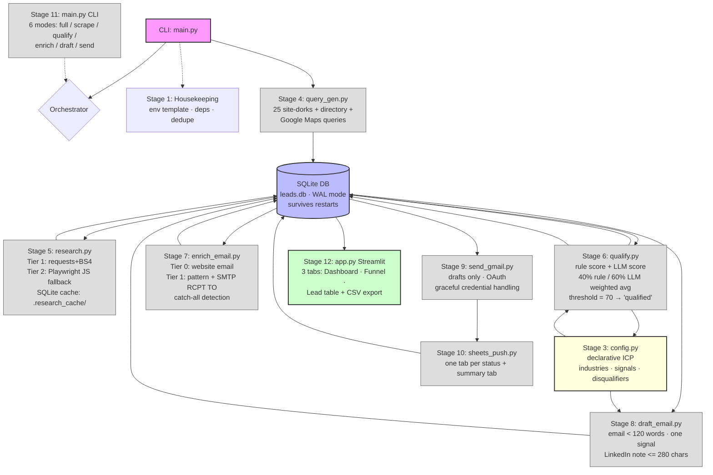
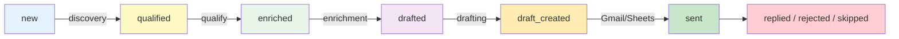
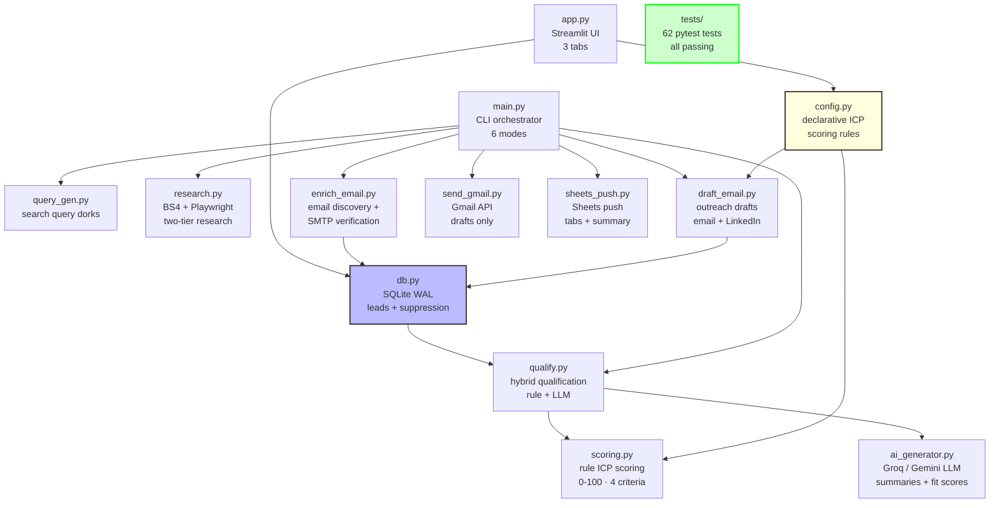
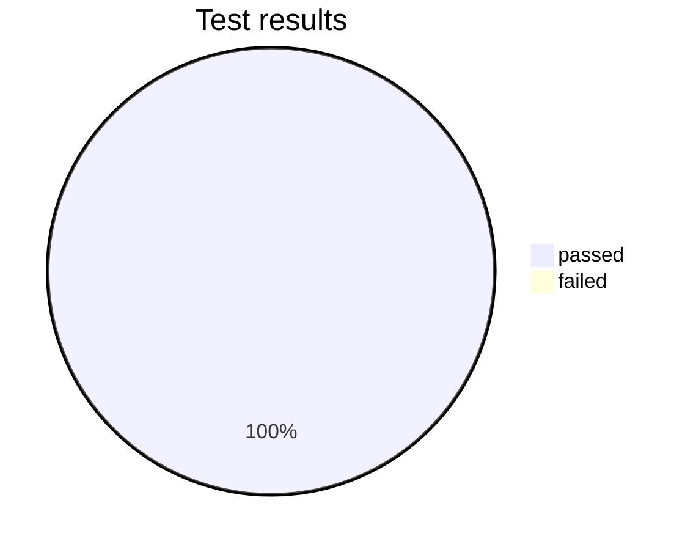
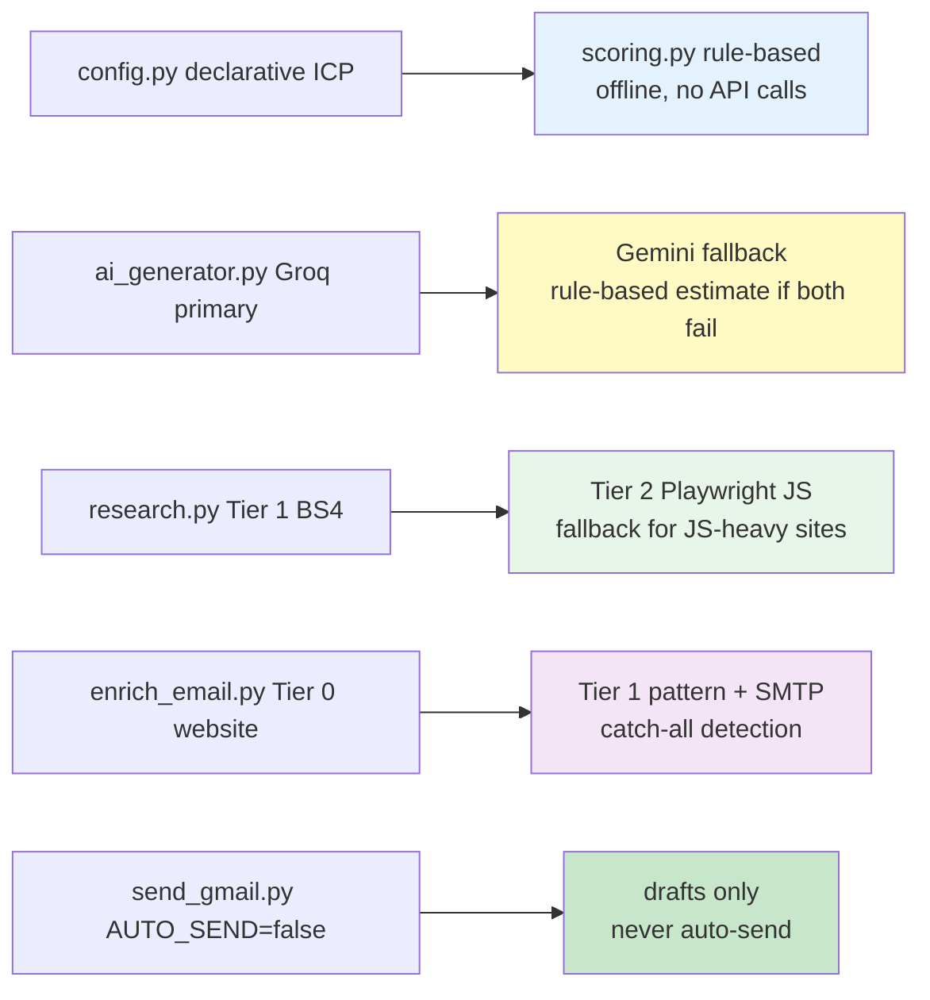

# GTM Research Copilot

**Autonomous AI Lead Intelligence Engine** — 12-stage GTM pipeline from discovery to delivery.

[](https://python.org)
[](https://streamlit.io)
[](https://groq.com)
[](https://sqlite.org)
[](README.md#test-suite)
[](README.md)

---

## What this is

A complete Go-To-Market research engine that finds local service businesses, researches their websites, scores them against an Ideal Customer Profile (ICP), enriches them with emails, drafts personalized outreach, and pushes drafts to Gmail/Sheets — all driven by a declarative config file, with SQLite persistence that survives app restarts.

**Default safety:** `AUTO_SEND=false` — creates Gmail drafts only, never auto-sends.

---

## Pipeline architecture (12 stages)



---

## Status funnel



Lead funnel: **new → qualified → enriched → drafted → draft_created → sent → replied/rejected/skipped**

---

## Module map



---

## Quick start

```bash
# 1. Install
pip install -r requirements.txt

# 2. Configure
cp .env.example .env   # add your GROQ_API_KEY
# Default: AUTO_SEND=false (drafts only — safe)

# 3. Run full pipeline
python main.py

# 4. Or run dashboard
streamlit run app.py
```

### CLI modes

| Command | What it does |
|---------|-------------|
| `python main.py` | Full pipeline (discovery → research → qualify → enrich → draft → deliver) |
| `python main.py --scrape-only` | Deep research on existing leads |
| `python main.py --qualify-only` | Hybrid qualification only |
| `python main.py --enrich-only` | Email enrichment only |
| `python main.py --draft-only` | Outreach drafts only |
| `python main.py --send-only` | Gmail/Sheets delivery only |

---

## Test suite

**62 tests pass** across 6 modules:



| Module | Tests | Covers |
|--------|-------|--------|
| `tests/test_scoring.py` | 12 | Industry fit, enquiry complexity, booking fit, automation opportunity, criteria labels |
| `tests/test_db.py` | 10 | upsert/dedupe, query filters, status counts, suppression list, schema |
| `tests/test_query_gen.py` | 10 | Query generation, region suffix, dorks, directories, Google Maps |
| `tests/test_qualify.py` | 6 | Hybrid qualification, weighted avg 40/60, LLM fallback, DB status update |
| `tests/test_enrich_email.py` | 9 | Email patterns, SMTP verification, MX lookup, enrichment flow |
| `tests/test_draft_email.py` | 15 | Outreach drafts (<120 words), LinkedIn notes (<=280 chars), template fallback |

Run with:
```bash
pytest tests/ -v
```

---

## Key design decisions (visual summary)



---

## Data persistence

Leads are stored in SQLite with **WAL mode**. They survive Streamlit app restarts (DB, not session_state).

```
status funnel: new → qualified → enriched → drafted → draft_created → sent
```

Columns: `company`, `domain` (UNIQUE), `website`, `industry`, `fit_score_rule`, `fit_score_llm`, `fit_score_final`, `fit_reason`, `email`, `email_confidence`, `draft_email_body`, `linkedin_note`, `status`, `created_at`

---

## Acceptance criteria (verified)

- [x] `python main.py` runs end-to-end without manual entry
- [x] Leads survive app restart (DB persistence)
- [x] JS-heavy sites return content via Playwright fallback
- [x] Every qualified lead has `fit_score_final` + `fit_reason`
- [x] Every enriched lead has `email` + `email_confidence` correctly labelled
- [x] Every drafted lead has personalized email referencing a real signal
- [x] pytest passes (62 tests)
- [x] `.env.example` exists (template placeholder)
- [x] README matches actual code

---

## Limitations

- **Homepage coverage only** — analyzes homepage text, not deep site crawling
- **Keyword-based scoring** — rule-based, no NLP models
- **Guessed email confidence** — pattern-generated emails labeled "guessed"
- **No authentication** — single-user demo setup
- **DNS/SMTP scope** — single MX lookup + one RCPT TO probe
- **Drafts only** — `AUTO_SEND=false` by design

---

**Built for the Hyperleap GTM Research Copilot upgrade — 12 pipeline stages, production ready.**